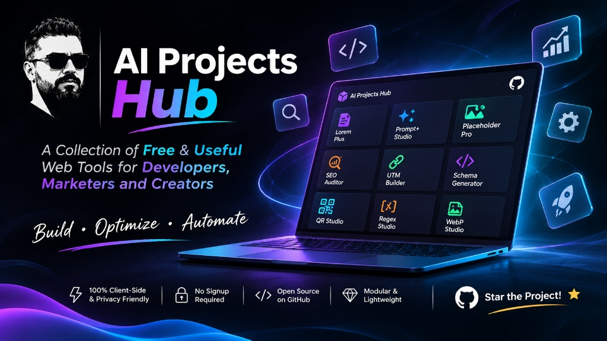

<p align="center">
  
</p>

# 🚀 پروژه‌های ساخته‌شده با هوش مصنوعی (AI Projects Hub)

مجموعه ابزارها و میکرواپ‌های وب مدرن که با دستیاری هوش مصنوعی کدنویسی و توسعه یافته‌اند (میزبانی شده روی **GitHub Pages**).

> ⭐️ **اگر این مجموعه ابزارها برای شما کاربردی بود، لطفاً با زدن یک Star در گیت‌هاب و دنبال کردن در لینکدین از توسعه ابزارهای جدیدتر حمایت کنید!**

🔗 **مشاهده ویترین آنلاین پروژه‌ها:** [hashemsh.github.io/ai-projects-persian](https://hashemsh.github.io/ai-projects-persian/)

---

## 📂 ساختار ریپازیتوری (Repository Architecture)

این ریپازیتوری به‌صورت چندپروژه‌ای (Multi-Project) سازمان‌دهی شده و هر پروژه در دایرکتوری کاملاً مستقل با رعایت استانداردهای Clean Modular Web قرار دارد:

```plaintext
ai-projects-persian/
│
├── index.html                      # صفحه ویترین پروژه‌ها (Showcase Hub)
├── README.md                       # مستندات جامع ریپازیتوری
├── ROADMAP.md                      # نقشه راه و اهداف توسعه
├── assets/                         # دارایی‌ها، استایل‌ها و کامپوننت‌های مشترک سراسری
│   ├── css/
│   │   ├── hub.css                 # استایل‌های اختصاصی صفحه اصلی
│   │   └── components/
│   │       └── shared-nav.css      # استایل نوار ناوبری شیشه‌ای و فوتر مشترک تمام ابزارها
│   └── js/
│       ├── components/
│       │   └── shared-layout.js    # موتور تزریق ماژولار هدر، منو و فوتر مشترک به تمام پروژه‌ها
│       ├── data/                   # دیتای مرکزی پروژه‌ها (projects-data.js) و سوالات متداول
│       └── ui/                     # کنترلرهای رابط کاربری هاب
│
├── lorem-plus/                     # پروژه شماره ۱: لورم پلاس سئو
│   ├── index.html                  # اینترفیس لورم پلاس
│   ├── README.md                   # مستندات لورم پلاس
│   └── assets/                     # بنرها، استایل‌ها، فونت‌ها و اسکریپت‌ها
│
├── prompt-optimizer/               # پروژه شماره ۲: استودیو مهندسی پرامپت (Prompt+)
│   ├── index.html                  # اینترفیس پرامپت پلاس
│   ├── README.md                   # مستندات اختصاصی پروژه پرامپت‌پلاس
│   └── assets/                     # بنرها، استایل‌ها و ماژول‌های جاوااسکریپت
│
├── placeholder-pro/                # پروژه شماره ۳: استودیو تصویر ماکت (Placeholder Pro)
│   ├── index.html                  # اینترفیس پلیس‌هولدر پرو
│   ├── README.md                   # مستندات اختصاصی پلیس‌هولدر پرو
│   └── assets/                     # استایل‌ها، پالت‌ها، وکتورها و موتور رندر Canvas
│
├── site-auditor/                   # پروژه شماره ۴: ممیزی و آنالیزور جامع سایت (Site Auditor Pro)
│   ├── index.html                  # اینترفیس سایت آدیتور
│   ├── README.md                   # مستندات تخصصی آدیتور
│   └── assets/                     # موتور ارزیابی ۴ ستونه، گیج SVG و اکسپورتر
│
├── utm-builder/                    # پروژه شماره ۵: سازنده پیشرفته لینک‌های کمپین (UTM Builder Pro)
│   ├── index.html                  # اینترفیس یو‌تی‌ام بیلدر
│   ├── README.md                   # مستندات تخصصی ابزار
│   └── assets/                     # موتور سازنده، شبیه‌ساز GA4، کیوآرکد و Batch Matrix
│
├── schema-generator/               # پروژه شماره ۶: سازنده و اعتبارسنج داده‌های ساختاریافته (Schema Generator Pro)
│   ├── index.html                  # اینترفیس اسکیما ژنراتور
│   ├── README.md                   # مستندات تخصصی اسکیما ژنراتور
│   ├── favicon.svg                 # آیکون وکتور اختصاصی
│   └── assets/                     # الگوها، موتور ساخت و اعتبارسنجی و پیش‌نمایش گوگل
│
├── qr-studio/                      # پروژه شماره ۷: استودیو و ژنراتور کیوآرکد پیشرفته (QR Studio Pro)
│   ├── index.html                  # اینترفیس استودیو کیوآرکد
│   ├── README.md                   # مستندات اختصاصی استودیو کیوآرکد
│   └── assets/                     # موتور رندر وکتور، دیتابیندر، پالت‌ها و اسکنر
│
├── regex-studio/                   # پروژه شماره ۸: سازنده و تحلیل‌گر عبارات منظم (Regex AI Studio)
│   ├── index.html                  # اینترفیس استودیو رجکس
│   ├── README.md                   # مستندات اختصاصی پروژه رجکس
│   └── assets/                     # هایلایتر زنده، موتور تشریح ساختار، تبدیل NLP و خروجی کد
│
├── webp-converter/                 # پروژه شماره ۹: مبدل و فشرده‌ساز تصاویر (WebP Studio Pro)
│   ├── index.html                  # اینترفیس مبدل وب‌پی
│   ├── README.md                   # مستندات اختصاصی پروژه وب‌پی
│   └── assets/                     # موتور رندر و فشرده‌سازی Canvas، دراپ‌زون و دانلود دسته‌ای
│
└── ai-cost-estimator/              # پروژه شماره ۱۰: محاسبه‌گر هزینه مدل‌های هوش مصنوعی (AI Cost Estimator)
    ├── index.html                  # اینترفیس محاسبه‌گر هزینه مدل‌ها
    ├── README.md                   # مستندات تخصصی محاسبه‌گر هزینه مدل‌ها
    └── assets/                     # موتور قیمت‌گذاری، جدول مقایسه، لوگوهای WebP و دانشنامه اشتراک‌ها
```

---

## 🌟 فهرست ابزارهای فعال (Active Projects)

هر پروژه دارای مستندات و راهنمای فنی مستقل در پوشه اختصاصی خود است:

1. **[لورم پلاس (Lorem Plus)](https://hashemsh.github.io/ai-projects-persian/lorem-plus/)** • [مستندات کامل](./lorem-plus/README.md)
   - تولیدکننده هوشمند محتوای فارسی، مقاله‌ساز سئو و اسکیماساز FAQ

2. **[پرامپت‌پلاس (Prompt+)](https://hashemsh.github.io/ai-projects-persian/prompt-optimizer/)** • [مستندات کامل](./prompt-optimizer/README.md)
   - استودیو مهندسی پرامپت هوش مصنوعی با ترفند دوزبانه و عیارسنجی زنده

3. **[پلیس‌هولدر پرو (Placeholder Pro)](https://hashemsh.github.io/ai-projects-persian/placeholder-pro/)** • [مستندات کامل](./placeholder-pro/README.md)
   - ژنراتور تصویر ماکت، وکتورهای SVG و عکس‌های استوک با ابعاد استاندارد

4. **[سایت آدیتور پرو (Site Auditor Pro)](https://hashemsh.github.io/ai-projects-persian/site-auditor/)** *(در حال توسعه ⏳)* • [مستندات کامل](./site-auditor/README.md)
   - استودیوی ممیزی سئو، پرفورمنس، پیش‌نمایش سرپ و بررسی دسترسی‌پذیری

5. **[یو‌تی‌ام بیلدر پرو (UTM Builder Pro)](https://hashemsh.github.io/ai-projects-persian/utm-builder/)** • [مستندات کامل](./utm-builder/README.md)
   - سازنده هوشمند لینک‌های کمپین، شبیه‌ساز GA4، کیوآرکد و خروجی گروهی اکسل

6. **[اسکیما ژنراتور پرو (Schema Generator Pro)](https://hashemsh.github.io/ai-projects-persian/schema-generator/)** • [مستندات کامل](./schema-generator/README.md)
   - سازنده و اعتبارسنج داده‌های ساختاریافته JSON-LD، شبیه‌ساز زنده نتایج گوگل و عیب‌یاب خطاهای سئو فنی

7. **[استودیو کیوآرکد پرو (QR Studio Pro)](https://hashemsh.github.io/ai-projects-persian/qr-studio/)** • [مستندات کامل](./qr-studio/README.md)
   - استودیوی ساخت کدهای QR برای ۵ فرمت کاربردی (لینک، وای‌فای، واتساپ با پیام آماده، تلگرام، اینستاگرام) با آپلود لوگو و خروجی وکتور SVG و PNG

8. **[سازنده و تحلیل‌گر عبارات منظم (Regex AI Studio)](https://hashemsh.github.io/ai-projects-persian/regex-studio/)** • [مستندات کامل](./regex-studio/README.md)
   - ابزار تخصصی ساخت، تست زنده، اعتبارسنجی و تشریح مرحله‌به‌مرحله الگوهای Regex با پریست‌های بومی ایران و مولد کد ۸ زبان

9. **[مبدل و فشرده‌ساز تصاویر به WebP (WebP Studio Pro)](https://hashemsh.github.io/ai-projects-persian/webp-converter/)** • [مستندات کامل](./webp-converter/README.md)
   - تبدیل و فشرده‌سازی آنلاین انواع تصاویر به WebP با کاهش حجم تا ۸۵٪، حفظ ترنسپرنسی و دانلود گروهی ۱۰۰٪ محلی در مرورگر

10. **[محاسبه‌گر هزینه هوش مصنوعی (AI Cost Estimator)](https://hashemsh.github.io/ai-projects-persian/ai-cost-estimator/)** • [مستندات کامل](./ai-cost-estimator/README.md)
    - محاسبه و مقایسه زنده هزینه‌های تصویر (Google Nano Banana, Midjourney, FLUX)، ویدیو (Runway, Luma, Kling)، کدنویسی (Claude 3.5, DeepSeek V3, Cursor, v0) و چت به دلار و معادل تومان همراه با دانشنامه اشتراک ماهانه

---

## 💻 نحوه اجرای محلی (Local Setup)

1. کلون کردن ریپازیتوری:
   ```bash
   git clone https://github.com/hashemsh/ai-projects-persian.git
   ```
2. ورود به پوشه:
   ```bash
   cd ai-projects-persian
   ```
3. تمامی پروژه‌ها ۱۰۰٪ مستقل و بدون نیاز به بیلد یا سرور Node.js هستند؛ کافیست فایل‌های `index.html` هر پوشه را مستقیماً در مرورگر اجرا کنید.

---

## 🗺️ نقشه راه و اهداف آینده (Roadmap)

لیست کامل برنامه‌ها، تسک‌های در دست اجرا، قابلیت‌های زیرساختی (نظیر تم دارک/لایت، سیستم دونیت و ماژولارسازی هدر/فوتر) و فهرست میکرواپ‌های در نوبت توسعه در فایل اختصاصی زیر مستندسازی و پیگیری می‌شوند:

👉 **[مشاهده چک‌لیست نقشه راه (ROADMAP.md)](./ROADMAP.md)**

---

## 👨‍💻 سازنده و حقوق معنوی

- **طراحی و توسعه:** [Hashem Sh](https://github.com/hashemsh)
- **لینکدین:** [hashemsheikhypour](https://www.linkedin.com/in/hashemsheikhypour)
- **تلگرام:** [@init10](https://t.me/init10)
- **قدرت‌گرفته از:** [Antigravity](https://deepmind.google/technologies/gemini/)
