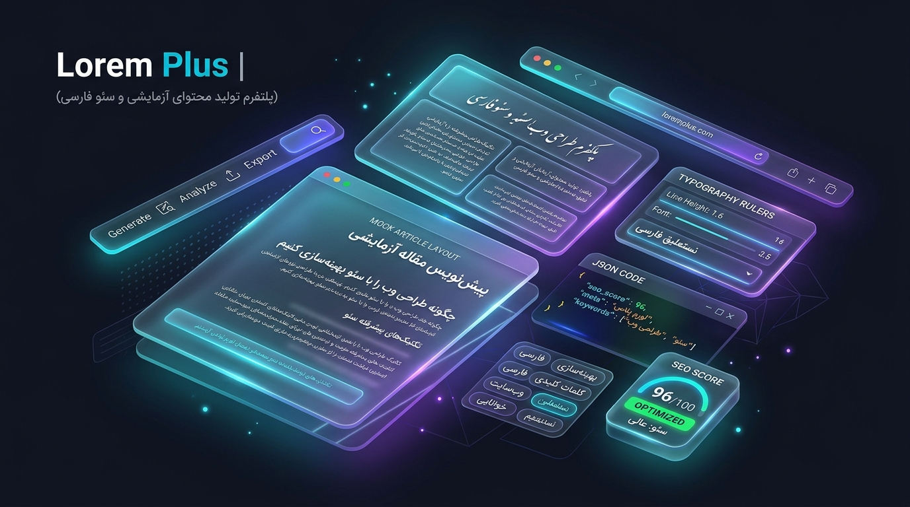

# 📜 لورم پلاس (Lorem Plus) | ژنراتور هوشمند محتوا و لورم ایپسوم تخصصی فارسی

نسخه ۳.۰ پرو — ابزار پیشرفته تولید متن ساختگی، مقاله‌ساز سئو، میکروکپی‌های UI، اسکیما مارک‌آپ گوگل و تصاویر ماکت برای طراحان وب و سئوکاران.

[](https://hashemsh.github.io/ai-projects-persian/lorem-plus/)
[](https://hashemsh.github.io/ai-projects-persian/)



---

## 🎯 درباره پروژه

در طراحی رابط کاربری (UI/UX) و سئوی سایت‌های فارسی‌زبان، متون لورم ایپسوم سنتی لاتین به دلیل تفاوت در کشیدگی حروف، ریتم عمودی و چگالی کلمات، ارزیابی واقعی چیدمان را دشوار می‌کنند.

**«لورم پلاس»** با هدف حل این چالش توسعه یافته است تا طراحان وب، توسعه‌دهندگان فرانت‌اند و کارشناسان سئو بتوانند در چند ثانیه محتواهایی واقع‌گرایانه، ساختاریافته و متناسب با سناریوی پروژه خود تولید و آزمایش کنند.

---

## ✨ امکانات و قابلیت‌های کلیدی

### ۱. 📜 ۶ قالب محتوایی کاربردی و هدفمند
- **لورم استاندارد:** متن‌های خنثی با تایپوگرافی متوازن برای ماکت اولیه صفحات.
- **لندینگ پیج خدماتی:** معرفی خدمات، مزیت‌های رقابتی، ویژگی‌های محصول و راهکارها.
- **حالت ساختار مقاله کامل وبلاگ (Blog Post Mode):** شامل تیتر اصلی مقاله، لید مقدماتی، تیترهای H2، زیرعنوان‌های H3، باکس نقل‌قول (`blockquote`)، لیست‌های بولت‌پوینت (`ul/li`) و نتیجه‌گیری پایانی برای تست کامل سلسله‌مراتب تایپوگرافی.
- **میکروکپی‌های آماده UI:**
  - **سوالات متداول (FAQ):** جفت‌های واقعی پرسش و پاسخ با استایل آکاردئونی شیشه‌ای.
  - **نظرات مشتریان (Testimonials):** نام کاربر، سمت شغلی، ستاره‌های امتیازدهی (★★★★★) و متن بازخورد.
  - **کارت‌های جدول قیمت (Pricing Tables):** نام پلن، نشان محبوبیت، قیمت، دوره پرداخت، لیست امکانات و دکمه کال‌تو‌اکشن.
- **معرفی شرکت و درباره ما:** داستان برند، بیانیه ماموریت، چشم‌انداز و ارزش‌های سازمانی.
- **کال‌تو‌اکشن فروشگاهی:** پیام‌های ترغیب‌کننده، آفرها، تخفیف‌های فوری و ثبت‌نام.

---

### ۲. 🎯 تزریق هوشمند کلمه کلیدی سئو (SEO Keyword Injection)
امکان وارد کردن کلیدواژه کانونی یا نام برند (مثلاً: `طراحی سایت` یا `دیجی‌پلاس`)؛ سیستم به‌صورت کاملاً ارگانیک کلمه را در تیترها و جملات جایگذاری کرده و با تگ `<strong>` (هایلایت فیروزه‌ای در پیش‌نمایش) نمایش می‌دهد تا چگالی کلمات کلیدی شبیه‌سازی شود.

---

### ۳. ⚡ تولیدکننده اسکیما مارک‌آپ گوگل (FAQ Schema JSON-LD)
با انتخاب حالت سوالات متداول، دکمه **«کپی اسکیما FAQ»** فعال می‌شود که کدهای ساختاریافته استاندارد گوگل (`https://schema.org/FAQPage`) را در قالب تگ `<script type="application/ld+json">` برای قرارگیری مستقیم در کدهای SEO سایت آماده می‌کند.

---

### ۴. 🔤 پیش‌نمایش زنده فونت و سایز (Live Font & Size Preview)
- سوییچ لحظه‌ای بین ۴ فونت محبوب و آزاد فارسی (لود شده از CDN پایدار jsDelivr):
  - **وزیرمتن (Vazirmatn)**
  - **شبنم (Shabnam)**
  - **صمیم (Samim)**
  - **ساحل (Sahel)**
- تغییر سریع اندازه قلم (`۱۴px`، `۱۶px`، `۱۸px` و `۲۰px`) برای سنجش خوانایی متون در رزولوشن‌های مختلف.

---

### ۵. 📊 نوار آمار زنده و نشانگر استاندارد طول متن برای سئو
- شمارش بلادرنگ تعداد پاراگراف‌ها، کلمات و کاراکترها.
- تخمین زمان مورد نیاز برای مطالعه متن.
- نشانگر هوشمند وضعیت طول محتوا برای سئو همراه با نشانگر رنگی:
  - 🟡 **کوتاه** (< ۳۰۰ کلمه): مناسب شبکه‌های اجتماعی، بنرها و میکروکپی.
  - 🔵 **متوسط** (۳۰۰ تا ۸۵۰ کلمه): استاندارد صفحات لندینگ پیج و معرفی خدمات.
  - 🟢 **ایده‌آل** (۸۵۰ تا ۲,۲۰۰ کلمه): استاندارد مقاله وبلاگی سئومحور.
  - 🟣 **جامع** (> ۲,۲۰۰ کلمه): راهنماهای عمیق و صفحات مرجع (Pillar Page).

---

### ۶. 💾 فرمت‌های خروجی چندگانه
- **پیش‌نمایش بصری:** رندر دقیق تگ‌ها و عناصر طراحی.
- **کد خام و تگ‌های HTML:** احاطه‌شده با تگ‌های معنایی آماده کپی.
- **خروجی ساختاریافته JSON:** ساختار دیتای مرتب شامل `id`، `type`، `title` و `content` ویژه برنامه‌نویسان فرانت‌اند جهت ساخت Mock Data و تست کامپوننت‌های React، Vue و Next.js.
- **دانلود مستقیم:** دریافت آنی خروجی در قالب فایل با پسوندهای `.html`، `.txt` یا `.json`.

---

## 🏗️ معماری ماژولار پروژه

این پروژه با پایبندی به اصول مهندسی نرم‌افزار و تفکیک دغدغه‌ها (Separation of Concerns) طراحی شده است:

```plaintext
lorem-plus/
│
├── index.html                  # ساختار تمیز، مقاله سئو و معنایی HTML
├── README.md                   # مستندات اختصاصی پروژه
└── assets/
    ├── images/
    │   └── lorem-plus-banner.jpg # بنر سه‌بعدی و نئونی معرفی استودیو
    ├── css/
    │   └── style.css           # استایل‌های شیشه‌ای، فونت‌های وب و اسکرول نرم
    └── js/
        ├── data.js             # مخزن جامع دیتای متون، مقالات، سوالات و قیمت‌ها
        └── app.js              # منطق پردازش، وضعیت برنامه، اسکیماساز و رویدادها
```

---

## 🛠️ تکنولوژی‌های به‌کاررفته

- **HTML5:** نشانه‌گذاری معنایی و رعایت اصول دسترسی‌پذیری و سئو
- **Tailwind CSS (CDN):** طراحی شیک، تیره و ریسپانسیو با افکت‌های شیشه‌ای
- **Vanilla JavaScript (ES6+):** کدنویسی مدرن، ماژولار و بهینه‌سازی‌شده برای اجرای مستقیم آفلاین و آنلاین
- **Schema.org JSON-LD:** استاندارد غنی‌سازی ساختار صفحات برای موتورهای جستجو
- **فونت‌های آزاد فارسی:** Vazirmatn، Shabnam، Samim، Sahel

---

## 🚀 نحوه اجرای محلی (Local Setup)

این پروژه نیاز به هیچ‌گونه نصب پکیج یا پیش‌پردازنده ندارد:

1. ریپازیتوری را کلون کرده یا پوشه `lorem-plus` را دانلود کنید:
   ```bash
   git clone https://github.com/hashemsh/ai-projects-persian.git
   ```
2. وارد پوشه پروژه شوید:
   ```bash
   cd ai-projects-persian/lorem-plus
   ```
3. فایل `index.html` را مستقیماً در هر مرورگری باز کنید.

---

## 👨‍💻 سازنده و حقوق معنوی

- **طراحی و توسعه:** [Hashem Sh](https://github.com/hashemsh)
- **قدرت‌گرفته از:** [Google Antigravity](https://deepmind.google/technologies/gemini/) & [Gemini Pro](https://gemini.google.com/)
- بخشی از مجموعه پروژه‌های ریپازیتوری [ai-projects-persian](https://github.com/hashemsh/ai-projects-persian)
