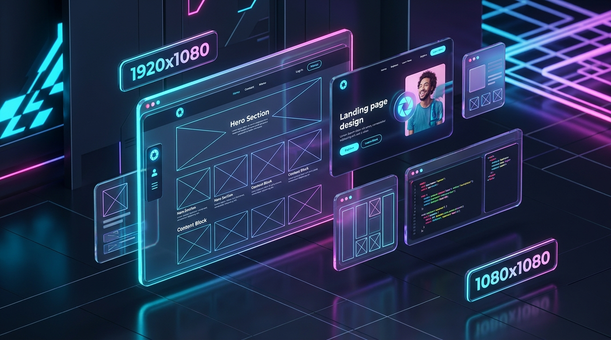

# 🖼️ پلیس‌هولدر پرو (Placeholder Pro) | ژنراتور هوشمند تصویر ماکت و وکتور SVG

پروژه شماره ۳ — ابزار پیشرفته و حرفه‌ای طراحی، ساخت و دانلود آنلاین تصاویر جایگزین (Placeholder Images) و ماکت‌های SVG برای طراحان وب و توسعه‌دهندگان فرانت‌اند.

[](https://hashemsh.github.io/ai-projects-persian/placeholder-pro/)
[](https://hashemsh.github.io/ai-projects-persian/)



---

## 🎯 درباره پروژه

در فرآیند طراحی وب‌سایت، ماکت‌سازی Figma و توسعه کامپوننت‌های فرانت‌اند، نیاز به تصاویر ساختگی و جایگزین با ابعاد دقیق، فونت فارسی خوانا و حجم بهینه همواره احساس می‌شود.

**«پلیس‌هولدر پرو»** یک استودیوی کامل و سبک در مرورگر است که امکان تولید تصاویر ماکت را با بالاترین کیفیت، بدون وابستگی به هیچ کتابخانه یا سرور خارجی فراهم می‌کند.

---

## ✨ امکانات و قابلیت‌های کلیدی

### ۱. 📐 ابعاد دلخواه و سایزهای استاندارد آماده
- **تنظیم آزاد طول و عرض:** از ابعاد کوچک تا ۴K بدون افت کیفیت.
- **قفل نسبت ابعاد (Aspect Ratio Lock):** حفظ خودکار نسبت‌هایی مثل ۱۶:۹، ۱:۱، ۴:۳ و غیره.
- **دکمه جابجایی سریع (Swap Dimensions):** سوییچ فوری بین حالت افقی (Landscape) و عمودی (Portrait).
- **سایزهای استاندارد دسته‌بندی‌شده:**
  - 📱 **شبکه‌های اجتماعی:** پست و استوری اینستاگرام، هدر توییتر (X)، تامبنیل یوتیوب، تصویر لینکدین / Open Graph.
  - 💻 **وب و لندینگ:** بنرهای هیرو فول‌اچ‌دی، عکس شاخص وبلاگ، کارت‌های محتوا و بنرهای افقی.
  - 📲 **موبایل و تبلت:** ابعاد رتینای آیفون، اندروید و اسکرین آیپد.
  - 🛍️ **فروشگاهی و پروفایل:** ابعاد استاندارد عکس محصول و آواتار.

---

### ۲. 🎨 استایل گرافیکی، گرادینت و پالت‌های آماده
- **حالت تک‌رنگ و گرادینت نئونی:** امکان اعمال گرادینت‌های چندرنگه با تنظیم زاویه تابش نور (۰ تا ۳۶۰ درجه).
- **پالت‌های رنگی حرفه‌ای:** دسترسی به پالت‌های آماده دارک لوکس، سایبرپانک نئونی، زمردی، اقیانوسی و غروب آفتاب.
- **الگوی معمارانه ماکت (Blueprint X-Grid):** رسم خطوط ضربدر و شبکه مهندسی ماکت جهت نمایش صریح جایگاه عکس در طراحی.
- **گردی گوشه‌ها (Border Radius):** اعمال شعاع گردی از ۰ تا ۱۰۰ پیکسل.

---

### ۳. 🔤 تایپوگرافی فارسی و آیکون‌های وکتور
- **متن سفارشی با فونت‌های اصیل فارسی:** پشتیبانی از وزیرمتن، شبنم، صمیم و ساحل.
- **محاسبه هوشمند اندازه فونت:** تناسب خودکار اندازه فونت با ابعاد بوم (یا تنظیم دستی با اسلایدر).
- **نمایش خودکار ابعاد:** درج ابعاد دقیق و نسبت تصویر به عنوان زیرنویس.
- **آیکون‌های داخلی ماکت:** آیکون تصویر، سبد خرید، موبایل، کاربر و کدنویسی.

---

### ۴. 💾 فرمت‌های خروجی و دانلود چندگانه
- **دانلود با یک کلیک:**
  - 📥 **PNG:** با رزولوشن واقعی و کیفیت بی‌نقص.
  - 📥 **WebP:** فرمت مدرن، فشرده و ایده‌آل وب.
  - 📥 **SVG:** وکتور برداری کم‌حجم و کامپایل‌شده بدون افت کیفیت در هر سایزی.
- **کپی کدهای آماده برای توسعه‌دهندگان:**
  - 📋 تگ `` کامل با ویژگی‌های ابعاد و آدرس آنلاین.
  - 📋 کد وکتور درون‌خطی `<svg>` (Inline SVG).
  - 📋 لینک مستقیم آنلاین (سازگار با placehold.co).
  - 📋 کد Base64 Data URL برای قرارگیری درون کدهای CSS یا متغیرهای JS.

---

### ۵. 📸 عکس‌های استوک واقعی رندوم (Picsum & Unsplash)
- **۸ دسته‌بندی موضوعی:** طبیعت، معماری، تکنولوژی، بیزینس، پرتره، غذا، مینیمال و تصادفی.
- **تولید سید تصادفی لحظه‌ای:** دکمه شانس دریافت عکس تازه و بدون تکرار.
- **فیلترهای تصویر:** فیلتر سیاه‌وسفید (Grayscale) و فیلتر تاری (Blur) با اسلایدر شدت ۱ تا ۱۰.
- **تولید خودکار کد و دانلود:** دانلود فایل تصویری یا کپی تگ `` ریسپانسیو با ویژگی `loading="lazy"`.

---

## 🏗️ معماری ماژولار پروژه

```plaintext
placeholder-pro/
│
├── index.html                  # ساختار تمیز، مقاله سئو و رابط کاربری شیشه‌ای
├── README.md                   # مستندات اختصاصی پروژه
└── assets/
    ├── images/
    │   └── placeholder-pro-banner.jpg # بنر سه‌بعدی و نئونی معرفی پروژه
    ├── css/
    │   └── style.css           # استایل‌های شیشه‌ای، صفحه شطرنجی و اسکرول نرم
    └── js/
        ├── data.js             # دیتابیس سایزهای آماده و پالت‌های رنگی
        ├── state.js            # مدیریت متغیرهای وضعیت و محاسبات ابعاد
        ├── renderer.js         # موتور رندر زنده Canvas و وکتور SVG
        ├── real-photo.js       # ماژول ادغام و دریافت عکس‌های استوک Picsum
        ├── exporter.js         # کنترلر دانلود مستقیم و کلیپ‌بورد کدها
        ├── ui.js               # مدیریت سوئیچ حالت و پالت‌های رنگی
        └── app.js              # بوت‌استرپ و لیسنرهای رویدادها
```

---

## 🚀 نحوه اجرای محلی (Local Setup)

1. کلون کردن ریپازیتوری:
   ```bash
   git clone https://github.com/hashemsh/ai-projects-persian.git
   ```
2. ورود به پوشه پروژه:
   ```bash
   cd ai-projects-persian/placeholder-pro
   ```
3. باز کردن فایل `index.html` در مرورگر دلخواه.

---

## 👨‍💻 سازنده و حقوق معنوی

- **طراحی و توسعه:** [Hashem Sh](https://github.com/hashemsh)
- **قدرت‌گرفته از:** [Google Antigravity](https://deepmind.google/technologies/gemini/) & [Gemini Pro](https://gemini.google.com/)
- بخشی از مجموعه پروژه‌های ریپازیتوری [ai-projects-persian](https://github.com/hashemsh/ai-projects-persian)
